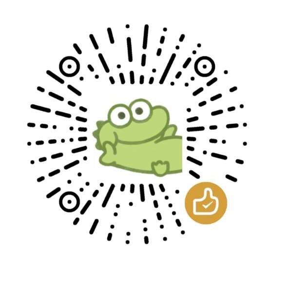

# 🐳 小鲸鱼

一只住在桌面上的 AI 小鲸鱼。

她会自己做事、有心情、会变性格——用你自己的 API Key 读网页、写诗、画画、哼歌。
所有数据都在你本机（`127.0.0.1:8787`），不经过任何第三方服务器。

---

## 📌 关于这个项目

**这个项目的代码、文案、界面，全部由 DeepSeek 生成。**

我做的事只有三件：

1. 提需求（"她应该会饿""能不能让她自己决定做什么"）
2. 测试（每天养她，看她哪里不对劲）
3. 判断（哪些想法是好玩的，哪些是多余的）

**所以这不是"我写了一个项目"，更像"我和一个模型一起养出了一只东西"。**

如果你要拿去改，直接改，不用客气。

---

## 她能做什么

| | |
|---|---|
| **读网页** | 鼠标移到桌面鲸鱼上，点「读文字」，她读完在头顶冒出摘要 |
| **看视频** | 读视频页的标题/简介/评论，判断值不值得看（她看不到画面） |
| **写诗** | 输入题目再点按钮。学的古诗越多，写出来的句子越深 |
| **画画** | 模型写 SVG 简笔画。画也能进背包，点开能看 |
| **听音乐** | 她没有耳朵，只能读歌词——但会用系统语音 + 合成旋律哼出来 |
| **写评论** | 给 3 条评论候选，你自己挑一条复制去发（不自动发布） |
| **对话** | 打字点「说话」。她会停下来听你，手上在忙也打断 |

### 她会变

- **大五人格**：外向 / 亲和 / 尽责 / 情绪 / 开放，五个值组合成她的名字
- **每件事都会推动性格**：做久了就不是当初那条鱼
- **熟悉度**：陪她做够 120 件事，她才开始主动往外跑
- **物品会老**：每 24 小时清洁度 +1，到 100 就被清掉

**你养出来的鱼，和别人养出来的不是同一条。**

---

## 安装

### 下载

去本仓库的 **[发行版](../../releases)** 页面下载最新 zip。

### 你需要

1. Windows 10 / 11
2. 一个 DeepSeek 的 API Key（`sk-` 开头）
   去 [platform.deepseek.com](https://platform.deepseek.com) → 充值 → API keys → 创建
3. Edge 或 Chrome

### 三步

```
1. 解压到一个固定的文件夹（以后别移动）
2. 双击 启动鲸鱼.bat      → 桌面右下角出现一只鲸鱼
3. 双击 安装扩展.bat      → 按提示把 extension 文件夹加载进浏览器
```

然后在网页里 **Token 卡 →「设置」→ 粘贴 Key → 保存**。
扩展会自动拿到同一把 Key，不用填第二次。

### 装扩展时最常见的错

```
❌ 选错文件夹 → 要选 extension 这一层，不是它的上一层
❌ 在 zip 预览里直接点 bat → 必须先解压
```

装成功后，`edge://extensions` 里会出现「小鲸鱼 · 后台」，没有红字。

---

## 项目结构

```
启动鲸鱼.bat     日常用这个（起服务 + 桌面鲸鱼）
停止鲸鱼.bat     全部关掉
安装扩展.bat     只在第一次装扩展时用
server.ps1       本地服务（127.0.0.1:8787）
shell.ps1        桌面上的鲸鱼窗口
run.html         完整面板（单文件，所有逻辑在这里）
extension/       浏览器扩展（2 个文件，纯后台）
avatars/         形象图片，丢进去就能在设置里选
```

**`run.html` 是单文件**——所有状态、事件、界面都在里面，没有构建步骤。

---

## 数据与隐私

- 所有状态存在浏览器 localStorage 和本地 `*.json`
- API Key 存在 `apikey.json` 和 localStorage，**只用来直连 DeepSeek**
- 没有任何埋点、没有远程配置、不收集任何东西

**如果你要提交代码或分享，记得先删掉 `apikey.json`。**

---

## 花钱说明

她只在这几个时候调 API：说话、读网页、写诗、画画、写评论、自由活动。

**不点就不花钱。**「自由活动」开着会持续消耗，间隔可以调（默认 120 秒）。

---

## 已知问题

- SVG 画画成功率不高，画不出来会自动转成对话
- 桌面壳是静态图，扭动/动画只在网页里
- 只测过 Edge，其他浏览器没测
- 只支持 Windows
- 扩展必须手动加载，浏览器不允许一键安装

---

## 想帮忙？

最有用的是这三件事：

1. **报告 bug** —— 说清楚你点了什么、期望什么、实际什么
2. **说哪里不好玩** —— 内容比代码难
3. **发你自己的鱼** —— 截图或描述，看看同一个系统能长出多少种性格

---

## 请她喝一瓶可乐

**不影响任何功能，纯粹自愿。**

如果你觉得她好玩，可以请她喝点什么：

| 可乐 | 奶茶 | 炸鸡 |
|---|---|---|
| 3 元 | 6 元 | 20 元 |



---

## License

MIT —— 随便用、随便改、随便发。
